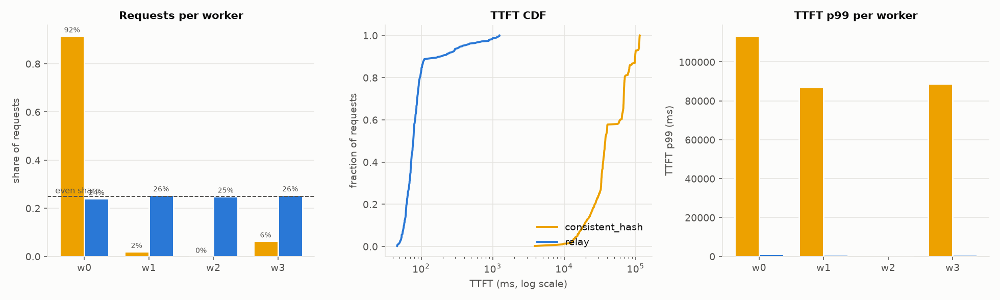

# Relay

Relay is a load balancer for LLM inference servers that sends each request to the worker most likely to already have its prompt prefix in the KV cache, without letting a popular prefix overload one worker.

LLM servers cache the prompts they've recently processed. A request that shares a prefix with one already cached (the same system prompt, earlier turns of a conversation, the same RAG document) skips recomputing it and gets its first token much sooner. Round-robin throws that away. Consistent hashing keeps it but piles a hot prefix onto a single worker. Relay scores workers on cache match, queue depth and KV usage, and caps how far above average any worker's load can go.

## Results

Simulated 4-worker cluster (real router and sidecars, emulated llama.cpp workers), 3 seeds per cell:

| policy | TTFT p99, shared-prefix workloads | cache hit rate | TTFT p99, hot prefix | max load at p99 ≤ 1 s |
|---|---:|---:|---:|---:|
| round_robin | 934 ms | 0.76 | 1145 ms | 6 req/s |
| least_loaded | 942 ms | 0.76 | 1121 ms | 6 req/s |
| consistent_hash | 6161 ms | 0.92 | 64828 ms | 2 req/s |
| relay | 835 ms | 0.87 | 950 ms | 8 req/s |

On 3 real llama.cpp workers (Qwen2.5-0.5B, CPU, one run per policy), relay had the best TTFT p99 (2.5 s vs 3.5–7.4 s) and the highest cache hit rate as llama.cpp measured it (0.93).

Killing a worker mid-stream, partitioning a worker, killing a router replica, and scaling workers down all completed with zero client-visible errors. Streams that lost their worker resumed on another one after a median pause of 480 ms.

Caveats: consistent hashing keeps a higher hit rate because it never replicates a prefix. On a workload with no shared prefixes, relay's p99 is slightly worse than least-loaded's unless `SCORE_GAMMA=0`. The GPU/vLLM benchmarks are scripted but haven't been run. Full numbers, graphs and methodology are in [docs/report.md](docs/report.md).



## Quickstart

You need Docker. The fastest way to try it is the router with three simulated workers, no model download:

```bash
git clone https://github.com/yousufmohi/relay && cd relay
docker compose -f deploy/docker-compose.yml --profile sim up --build -d simrouter

curl -N localhost:8081/v1/chat/completions -H 'Content-Type: application/json' \
  -d '{"messages":[{"role":"user","content":"Say hi"}],"max_tokens":32,"stream":true}'
curl localhost:8081/debug/workers   # per-worker load and cache view
```

To run against real models instead (three llama.cpp CPU workers serving Qwen2.5-0.5B-Instruct), use `make compose-up` and send the same request to port 8080.

## Development

Go 1.26+, Docker, and Python 3.11+ for the experiments.

```bash
make test                 # unit + integration tests
make build                # bin/{router,sidecar,autoscaler,loadgen,simworker}

make venv
make exp NAME=e1          # run one experiment (e1..e8, or all) on a local simulated cluster
make report               # re-plot everything from results/ into docs/report.md

make cluster-up           # k3d cluster with Prometheus, Grafana, Chaos Mesh, Jaeger
make exp-k8s NAME=e4      # same scenarios, failures injected by Chaos Mesh

make bench-gpu && make bench-down   # AWS spot GPU run, costs money (docs/decisions.md D20)
```

Without `make` on Windows, each target is a one-liner you can run directly, e.g. `python experiments/run.py e1`.

## How it works

```
  clients / load generator
            │  OpenAI-compatible streaming API (SSE)
            ▼
   ┌──────────────────┐   ┌──────────────────┐
   │ router replica A │   │ router replica B │   (soft state only)
   └───────┬──────────┘   └──────────┬───────┘
           │   gRPC stream: load + cache stats   │
           ▼                                     ▼
   ┌───────────────┐  ┌───────────────┐  ┌───────────────┐
   │ worker 1      │  │ worker 2      │  │ worker N      │
   │ model server  │  │      ...      │  │      ...      │
   │ + sidecar     │  │               │  │               │
   └───────────────┘  └───────────────┘  └───────────────┘
            ▲
   autoscaler ── scales workers on queue depth / TTFT
```

The router tokenizes each prompt and hashes it in 64-token blocks as a chain, so one hash identifies the whole prefix up to that block. For each worker it keeps an LRU set of the block hashes it has sent there, and picks the worker with the best score `α·match − β·queue − γ·kv_usage` among those under the load bound. A sidecar next to each model server streams live queue and cache stats to every router over gRPC, and handles draining on shutdown. If a worker dies or stalls mid-stream, the router sends the prompt plus the tokens generated so far to another worker and keeps streaming on the same connection.

The router, sidecar, autoscaler and load generator are written in Go. Experiments and plotting are in Python.

## Docs

- [docs/report.md](docs/report.md): results, graphs, and what didn't work
- [docs/design.md](docs/design.md): routing, failover, sidecar, autoscaler and experiment design
- [docs/configuration.md](docs/configuration.md): environment variables
- [docs/decisions.md](docs/decisions.md): design decisions and trade-offs
- [docs/milestones.md](docs/milestones.md): build milestones and acceptance criteria

## License

[MIT](LICENSE)
