# Relay — results report

> Generated by `make report` from `docs/report.template.md` and the raw results in `results/`.
> Every figure and table below is reproducible with one command (`make exp NAME=eN`).

**Where the numbers come from.** All results in this report were produced on a laptop (12 cores, Windows 11) with
the local experiment harness: real Relay router(s) and sidecars, and **simulated workers** (`simworker`) that speak
llama.cpp's API and model a prefix KV cache (4 slots, 24k-token cache, 0.4 ms per uncached prompt token, 20 ms per
decode step, +15 % per extra concurrent sequence — roughly a 7B model on one mid-range GPU; see decisions D16). The
router code path is identical to production. One experiment (E1 on real models) uses the docker-compose stack with
real llama.cpp CPU workers. **The GPU/vLLM benchmark (M7) has not been run yet** — the tooling is in
place (`make bench-gpu`, ≈ $5–10 per session); its sections will appear here once it has.

## 1. Problem

LLM servers keep a KV cache of recently processed prompts. A request whose prompt starts with an already-cached
prefix — a shared system prompt, earlier turns of the same conversation, the same RAG document — skips recomputing
that prefix, and prefill is most of time-to-first-token (TTFT). Load balancers that ignore cache contents
(round-robin, least-loaded) scatter requests sharing a prefix across workers and recompute it everywhere. Hashing the
prefix onto a ring (consistent hashing) keeps affinity but has no load awareness: one popular prefix melts one
worker. Relay routes on *both*.

## 2. Design (short)

* **Prefix block hashes.** The prompt is tokenized (worker `/tokenize`, cached per chat-template segment) and split
  into 64-token blocks hashed as a chain, `h_i = H(h_{i-1} ‖ block_i)`, so a hash names the whole prefix up to it.
* **Per-worker prefix index.** Each router keeps, per worker, an LRU set of block hashes it has sent there, sized
  from the sidecar-reported KV capacity and cleared when the sidecar reports a restart. Match length = number of
  leading hashes present. Soft state: losing it costs hits, never correctness.
* **Scoring.** `score = α·match_blocks − β·load − γ·kv_usage`, with **bounded load**: a worker may take the request
  only if `load+1 ≤ ceil(c·(total+1)/n)` (c = 1.25). Ties: fewer in-flight, then random.
* **Live stats.** A sidecar per worker scrapes the model server every 250 ms and streams `WorkerStats` (running,
  waiting, KV usage/capacity, prefix-cache counters, restart epoch, draining) to every router over gRPC.
* **Failover.** The router holds the prompt and every token forwarded. If the worker dies, stalls (no token for
  `STALL_TIMEOUT_MS`), or the pool marks it down, it sends `prompt + generated_so_far` to another worker with the
  remaining token budget and keeps streaming on the same client connection (≤ 2 failovers).
* **Admission.** Global concurrency limit (eligible workers × 8) with a bounded FIFO queue; requests that cannot
  start before their deadline get 429 + `Retry-After` immediately.
* **HA & scaling.** Two stateless router replicas, each with its own index. An autoscaler scales workers on queue
  depth and TTFT p95; scale-down drains through the sidecar (preStop hook) so no stream is cut.

## 3. Headline comparison

Simulated 4-worker cluster. E1 columns pool 3 seeds per cell; E2 columns are from the load sweep.

| policy | TTFT p99, shared-prefix workloads (ms, mean of 3) | cache hit rate, shared-prefix workloads | TTFT p99, unique (ms) | TTFT p99, hot-prefix (ms) | peak goodput @ p99≤1s (req/s) | max load meeting p99≤1s (req/s) |
|---|---:|---:|---:|---:|---:|---:|
| round_robin | 934 | 0.762 | 1433 | 1145 | 7.90 | 6 |
| least_loaded | 942 | 0.756 | 1473 | 1121 | 7.78 | 6 |
| consistent_hash | 6161 | 0.923 | 3366 | 64828 | 3.16 | 2 |
| **relay** | 835 | 0.874 | 1731 | 950 | 8.28 | 8 |
| **relay_floor4** | 749 | 0.904 | 1463 | 977 |  |  |

**Real-model check (llama.cpp, CPU, one run per policy — indicative):** on 3 llama.cpp workers serving
Qwen2.5-0.5B, relay had the best TTFT p50 (293 ms) and p99 (2.5 s vs 3.5–7.4 s) *and* the highest prefix-cache
hit rate as measured by llama.cpp itself (0.93 vs 0.90 consistent_hash, 0.83 least_loaded, 0.49 round_robin). A
cached ~620-token system prompt cut TTFT from 1.8 s to ~20 ms. See "E1 on real models" below.

**Findings (simulated cluster):**

1. **Relay beats round-robin and least-loaded on every shared-prefix workload, on both hit rate and TTFT p99**
   (E1): shared system prompt 0.89 vs 0.81 hit rate, p99 772 vs 881 ms; RAG 0.93 vs 0.84, p99 1199 vs 1360 ms;
   multi-turn 0.81 vs 0.63 hit rate with p50 halved (84 vs 160 ms).
2. **Relay sustains the most load at a 1 s p99 target** (E2): 8 req/s vs 6 for round-robin/least-loaded and 2 for
   consistent hashing, with the highest peak goodput.
3. **Bounded load prevents hotspots** (E3, E1 hot-prefix). consistent_hash sends 92 % of hot-prefix traffic to one
   worker and its p99 explodes to 45–65 s; relay keeps every worker within 24–27 % with p99 ≈ 1 s.
4. **consistent_hash still has the highest hit rate everywhere** (it never replicates a prefix). Relay trades a few
   points of hit rate for 2–60× lower p99. So the M3 criterion "beats *all* baselines on hit rate" is **not met**
   against consistent_hash; it is met against round-robin and least-loaded. With `LOAD_BOUND_FLOOR=4` (= worker
   slots, E8 + E1 `relay_floor4`) relay closes most of that gap — multi-turn 0.86 vs 0.88, RAG 0.95 vs 0.97 — and
   improves multi-turn p99 (399 vs 535 ms) without losing the hotspot protection.
5. **On `unique` (no sharing) relay ties least-loaded on mean, p90 and p95, but its p99 was higher in all three
   paired seeds** (1731 vs 1473 ms pooled). The γ·KV-usage term is the only difference when nothing matches; it
   uses sidecar data up to one scrape old. With γ = 0 the gap disappears (`experiments/check_gamma0.py`: p99
   1250 / 1611 / 1154 ms vs least-loaded 1425 / 1507 / 1077), and E8 shows γ = 0 is never worse on the other
   workloads. Recommended configuration for this setup: `SCORE_GAMMA=0`, `LOAD_BOUND_FLOOR=<worker slots>`;
   the code keeps the spec's defaults.
6. **c is the one parameter that matters** (E8): c ≥ 2 melts the hot prefix (p99 11.6 s at c = 2, 77 s without a
   bound), c = 1.0 costs up to 12 points of hit rate; 1.25–1.5 is the sweet spot. α, β, γ move p99 by less than the
   run-to-run noise once bounded load is in place.
7. **No failure produced a client-visible error**: rolling worker crashes (E4, 17 streams failed over, pause p50
   480 ms), a partition (E5, detected in 1.5 s), a router kill (E6, 56 requests retried on the other replica),
   and drained scale-downs (E7).

## 4. Results

## E1 — Routing policies across workloads (fixed load)

4 simulated workers (4 slots, 24k-token prefix cache each), one router, open-loop Poisson arrivals at each
workload's default rate, 10s warm-up excluded. Each run starts from cold caches; every cell pools 3 seeds
(~750 requests) because single-run p99s are too noisy to rank policies. `relay_floor4` is relay with
`LOAD_BOUND_FLOOR=4` (the workers' slot count), added after E8 suggested it.

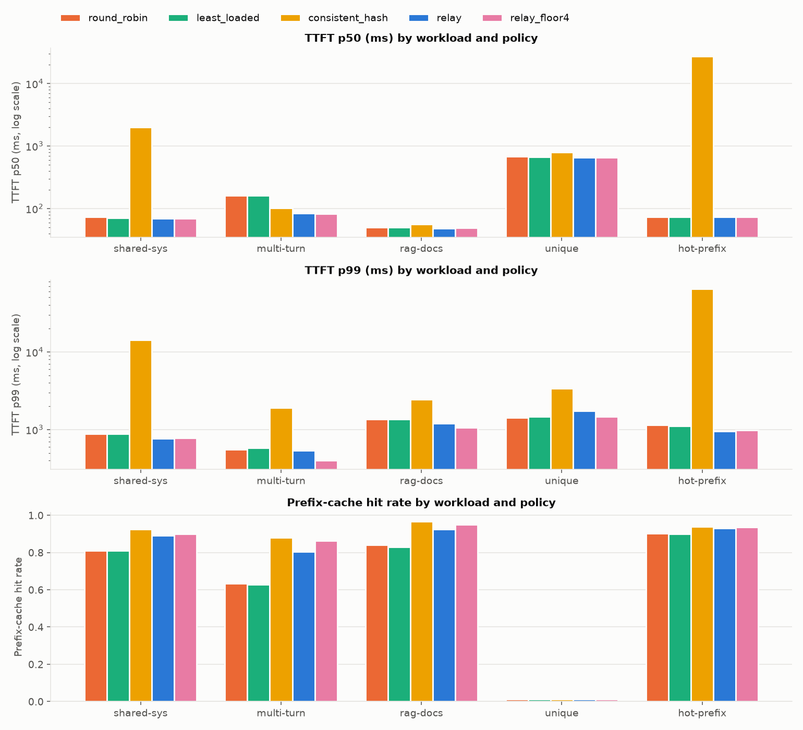

| workload | policy | TTFT p50 ms | TTFT p99 ms (pooled) | p99 range across seeds | hit rate | req/s | errors |
|---|---|---:|---:|---|---:|---:|---:|
| shared-system-prompt | round_robin | 74 | 882 | 789–886 | 0.811 | 4.99 | 0 |
| shared-system-prompt | least_loaded | 72 | 881 | 855–885 | 0.811 | 4.99 | 0 |
| shared-system-prompt | consistent_hash | 1980 | 14154 | 3056–14375 | 0.924 | 4.99 | 0 |
| shared-system-prompt | relay | 70 | 772 | 685–781 | 0.890 | 4.99 | 0 |
| shared-system-prompt | relay_floor4 | 70 | 784 | 710–853 | 0.899 | 4.99 | 0 |
| multi-turn-chat | round_robin | 160 | 552 | 517–591 | 0.633 | 4.02 | 0 |
| multi-turn-chat | least_loaded | 162 | 586 | 518–587 | 0.628 | 4.00 | 0 |
| multi-turn-chat | consistent_hash | 101 | 1896 | 733–1999 | 0.879 | 3.87 | 0 |
| multi-turn-chat | relay | 84 | 535 | 481–583 | 0.806 | 4.03 | 0 |
| multi-turn-chat | relay_floor4 | 83 | 399 | 334–432 | 0.863 | 3.98 | 0 |
| rag-shared-docs | round_robin | 50 | 1367 | 1254–1367 | 0.841 | 4.04 | 0 |
| rag-shared-docs | least_loaded | 50 | 1360 | 1212–1362 | 0.830 | 4.04 | 0 |
| rag-shared-docs | consistent_hash | 56 | 2432 | 1804–2644 | 0.967 | 4.04 | 0 |
| rag-shared-docs | relay | 48 | 1199 | 1058–1200 | 0.926 | 4.04 | 0 |
| rag-shared-docs | relay_floor4 | 49 | 1063 | 1058–1168 | 0.951 | 4.04 | 0 |
| unique | round_robin | 687 | 1433 | 1176–1546 | 0.012 | 4.99 | 0 |
| unique | least_loaded | 665 | 1473 | 1077–1507 | 0.012 | 4.99 | 0 |
| unique | consistent_hash | 788 | 3366 | 2075–4072 | 0.012 | 4.99 | 0 |
| unique | relay | 658 | 1731 | 1116–1885 | 0.012 | 4.99 | 0 |
| unique | relay_floor4 | 662 | 1463 | 1158–1722 | 0.012 | 4.99 | 0 |
| hot-prefix | round_robin | 74 | 1145 | 1055–1206 | 0.903 | 5.95 | 0 |
| hot-prefix | least_loaded | 73 | 1121 | 1005–1134 | 0.900 | 5.95 | 0 |
| hot-prefix | consistent_hash | 27028 | 64828 | 33922–71528 | 0.940 | 5.95 | 0 |
| hot-prefix | relay | 74 | 950 | 879–999 | 0.931 | 5.95 | 0 |
| hot-prefix | relay_floor4 | 74 | 977 | 903–995 | 0.937 | 5.95 | 0 |

## E1 on real models — llama.cpp CPU workers

The docker-compose stack: router + 3 llama.cpp workers (Qwen2.5-0.5B-Instruct Q4_K_M, 4 slots, 2 CPU threads each)
with sidecars, `shared-system-prompt` at 0.4 req/s for 120s with 16-token answers (CPU prefill
of a ~1.3k-token system prompt takes seconds, so the load is light). Hit rate comes from llama.cpp's own
`timings.cache_n`. One run per policy, so treat p99 (a handful of requests) as indicative only.

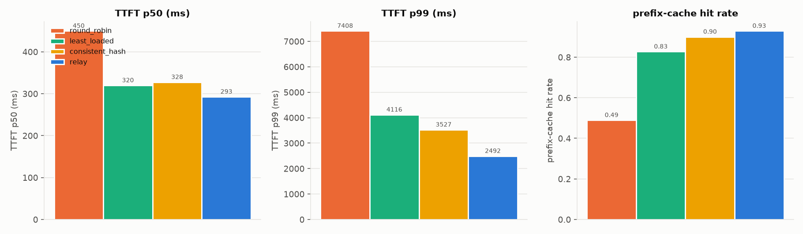

| policy | requests | TTFT p50 ms | TTFT p99 ms | hit rate (llama.cpp cache_n) | errors |
|---|---:|---:|---:|---:|---:|
| round_robin | 37 | 450 | 7408 | 0.489 | 0 |
| least_loaded | 37 | 320 | 4116 | 0.827 | 0 |
| consistent_hash | 37 | 328 | 3527 | 0.900 | 0 |
| relay | 37 | 293 | 2492 | 0.929 | 0 |

## E2 — Load sweep to saturation (goodput)

Workload `shared-system-prompt`, 4 workers, each point a fresh cluster. Goodput = completed requests per second whose TTFT met
the 1000 ms target.

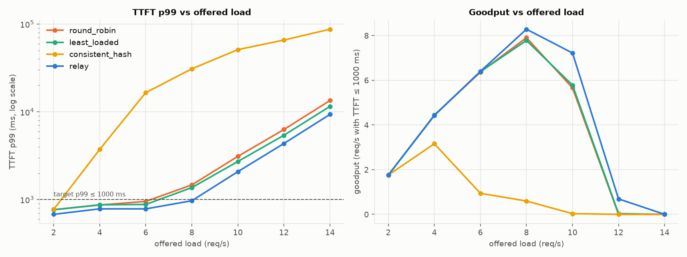

| policy | max load meeting p99 ≤ 1000 ms (req/s) | peak goodput (req/s) |
|---|---:|---:|
| round_robin | 6 | 7.90 |
| least_loaded | 6 | 7.78 |
| consistent_hash | 2 | 3.16 |
| relay | 8 | 8.28 |

All runs

| policy | offered req/s | p50 ms | p99 ms | req/s | goodput | hit rate | err rate |
|---|---:|---:|---:|---:|---:|---:|---:|
| round_robin | 2 | 75 | 768 | 1.76 | 1.76 | 0.598 | 0.000 |
| round_robin | 4 | 71 | 869 | 4.44 | 4.44 | 0.774 | 0.000 |
| round_robin | 6 | 78 | 955 | 6.40 | 6.37 | 0.824 | 0.000 |
| round_robin | 8 | 94 | 1471 | 8.34 | 7.90 | 0.828 | 0.000 |
| round_robin | 10 | 844 | 3109 | 9.85 | 5.66 | 0.842 | 0.000 |
| round_robin | 12 | 4077 | 6287 | 11.66 | 0.00 | 0.844 | 0.000 |
| round_robin | 14 | 7984 | 13438 | 14.02 | 0.00 | 0.842 | 0.000 |
| least_loaded | 2 | 76 | 768 | 1.76 | 1.76 | 0.632 | 0.000 |
| least_loaded | 4 | 72 | 873 | 4.44 | 4.44 | 0.747 | 0.000 |
| least_loaded | 6 | 79 | 882 | 6.39 | 6.39 | 0.824 | 0.000 |
| least_loaded | 8 | 92 | 1370 | 8.35 | 7.78 | 0.802 | 0.000 |
| least_loaded | 10 | 805 | 2719 | 9.85 | 5.78 | 0.849 | 0.000 |
| least_loaded | 12 | 3716 | 5407 | 11.66 | 0.03 | 0.860 | 0.000 |
| least_loaded | 14 | 7907 | 11534 | 14.01 | 0.00 | 0.861 | 0.000 |
| consistent_hash | 2 | 67 | 774 | 1.76 | 1.76 | 0.871 | 0.000 |
| consistent_hash | 4 | 118 | 3733 | 4.44 | 3.16 | 0.906 | 0.000 |
| consistent_hash | 6 | 6578 | 16545 | 6.40 | 0.94 | 0.916 | 0.000 |
| consistent_hash | 8 | 17501 | 30856 | 8.35 | 0.60 | 0.925 | 0.000 |
| consistent_hash | 10 | 25125 | 51037 | 9.84 | 0.03 | 0.930 | 0.000 |
| consistent_hash | 12 | 34392 | 65607 | 11.66 | 0.00 | 0.934 | 0.000 |
| consistent_hash | 14 | 38746 | 87166 | 14.02 | 0.00 | 0.933 | 0.000 |
| relay | 2 | 63 | 680 | 1.76 | 1.76 | 0.837 | 0.000 |
| relay | 4 | 71 | 786 | 4.42 | 4.42 | 0.833 | 0.000 |
| relay | 6 | 75 | 785 | 6.40 | 6.40 | 0.884 | 0.000 |
| relay | 8 | 87 | 971 | 8.35 | 8.28 | 0.893 | 0.000 |
| relay | 10 | 260 | 2084 | 9.84 | 7.22 | 0.918 | 0.000 |
| relay | 12 | 2400 | 4355 | 11.66 | 0.69 | 0.924 | 0.000 |
| relay | 14 | 5966 | 9347 | 14.03 | 0.00 | 0.927 | 0.000 |

## E3 — Hot-prefix skew: bounded load prevents a hotspot

Workload `hot-prefix` (90% of requests share one 2000-token prefix) at 8 req/s on 4 workers.

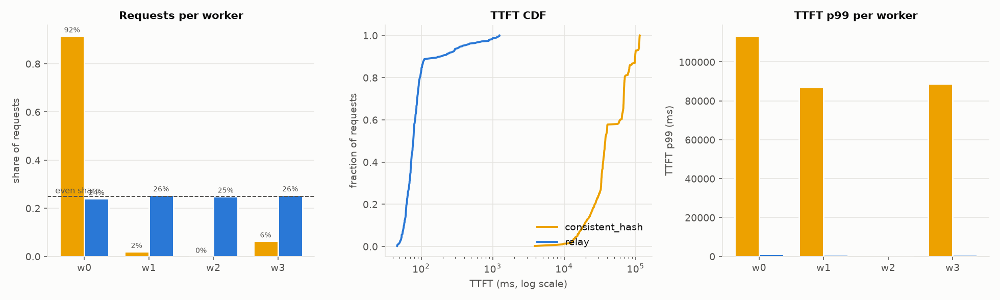

| policy | TTFT p50 ms | TTFT p99 ms | hit rate | busiest worker share | errors |
|---|---:|---:|---:|---:|---:|
| consistent_hash | 37593 | 113325 | 0.943 | 0.92 | 0 |
| relay | 77 | 1129 | 0.938 | 0.26 | 0 |

Request share per worker:

| policy | w0 | w1 | w2 | w3 |
|---|---:|---:|---:|---:|
| consistent_hash | 0.92 | 0.02 | 0.00 | 0.06 |
| relay | 0.24 | 0.26 | 0.25 | 0.26 |

## E4 — Killing workers mid-stream

`relay` policy, 4 workers, `shared-system-prompt` at 3 req/s with 120-token responses (long streams, so the kill lands
mid-generation). Rolling crashes: every 10 s from 15 s one worker is killed (SIGKILL, no drain) and restarted 5 s
later with an empty cache, so at most one of four workers is down at a time.

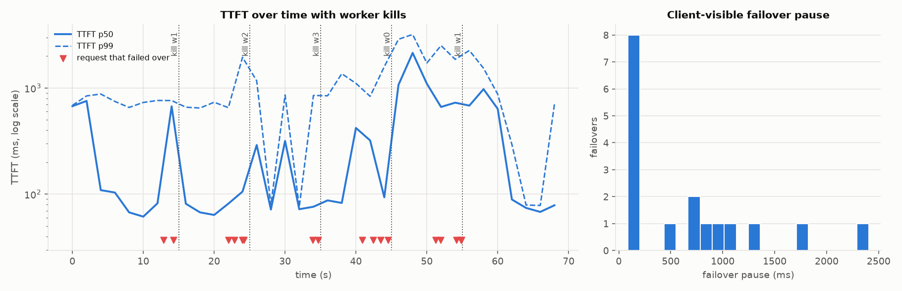

| requests | client-visible errors | requests that failed over | failovers | pause p50 ms | pause p99 ms | pause max ms |
|---:|---:|---:|---:|---:|---:|---:|
| 220 | 0 | 17 | 17 | 480 | 2298 | 2405 |

| kill | streams failed over | pause p50 ms | pause max ms |
|---|---:|---:|---:|
| w1 at 15s | 2 | 402 | 692 |
| w2 at 25s | 4 | 779 | 1042 |
| w3 at 35s | 2 | 103 | 120 |
| w0 at 45s | 4 | 539 | 2405 |
| w1 at 55s | 5 | 480 | 1736 |

Every request that was streaming on a killed worker was continued on another worker on the same client connection;
the client sees a pause, not an error. The pause is dominated by re-prefilling `prompt + generated_so_far` on the new
worker (the dead worker's KV cache is lost) plus any wait for a free slot there. In an earlier run with a second kill
(2 of 4 workers left, 200-token streams) the survivors were overloaded and pauses grew to 4–6 s of queueing: failover
keeps streams alive but cannot create capacity.

## E5 — Network partition of one worker

Worker w1 is partitioned from 20 s to 40 s (its model server stops responding and its sidecar stream goes silent).
Detection uses three independent signals, whichever fires first: sidecar silence (> `SIDECAR_TIMEOUT_MS` = 1.5 s),
failed active health checks (every 0.5 s here), and the per-stream stall timer (`STALL_TIMEOUT_MS` = 1.5 s here).
In-flight streams on w1 are abandoned as soon as the pool marks it down and continued elsewhere.

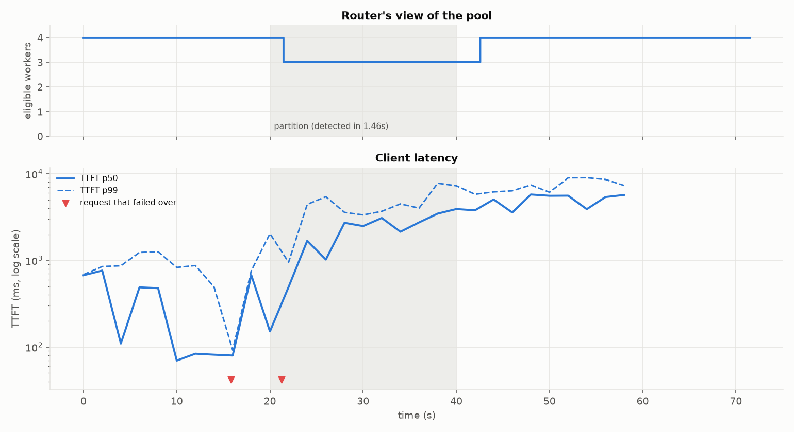

| requests | client-visible errors | error rate | failovers | detection time (s) | time to re-admit after heal (s) | max failover pause (ms) |
|---:|---:|---:|---:|---:|---:|---:|
| 194 | 0 | 0.000 | 2 | 1.46 | 2.56 | 1692 |

## E6 — Killing a router replica

Two router replicas, each building its own prefix index from its own decisions and its own sidecar streams (no shared
state). The load generator spreads requests over both and retries connection failures on the other replica. Router-1
is killed at 20 s and restarted at 35 s with an empty index. (Requests are bucketed by start time, so streams that
started on router-1 shortly before the kill show up as retries just before 20 s.)

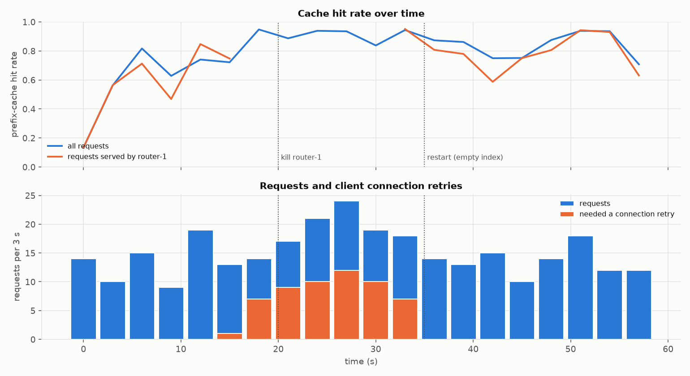

| requests | dropped (client-visible errors) | requests that needed a connection retry | hit rate before kill | one router | first 5 s after restart | last 15 s |
|---:|---:|---:|---:|---:|---:|---:|
| 301 | 0 | 56 | 0.745 | 0.911 | 0.893 | 0.854 |

## E7 — Traffic spike with the autoscaler

Offered load steps 2 → 10 → 2 req/s (`spike` workload, 420 s). The autoscaler (targets: 2 queued requests per
worker, TTFT p95 1500 ms; 10 s sustained window to scale up, 60 s to scale down, min 2 / max 8) reads the routers'
metrics; scale-down drains a worker through its sidecar before stopping it.

A first attempt used the production TTFT target (800 ms) and a 30 s down window. It scaled up 41 s *before* the
spike, because on these workers a cold-cache prefill of a 1500-token system prompt alone takes ~950 ms. It also
started draining workers while the spike was still running, because with 8 workers both signals dropped below half
the target. It still had 0 client errors (raw data in `results/e7-first-attempt/`). Lesson: the TTFT target must
sit above the uncached-prefill cost of the workload, and the down window must outlast a burst.

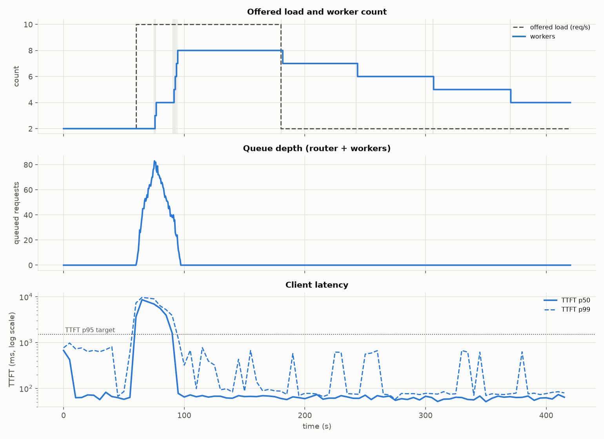

| requests | client-visible errors | peak workers | scale-up steps | first scale-up after spike (s) | TTFT p99 first 30 s of spike (ms) | TTFT p99 last 60 s of spike (ms) | drained scale-downs | errors during scale-down |
|---:|---:|---:|---:|---:|---:|---:|---:|---:|
| 1819 | 0 | 8 | 6 | 15 | 9347 | 101 | 4 | 0 |

## E8 — Parameter sensitivity (α, β, γ, c)

One parameter varied at a time around the defaults (α=1, β=0.5, γ=0.5, c=1.25, floor 0; dotted line), 4 workers,
near saturation where the load terms matter (8 req/s; multi-turn 6 req/s).

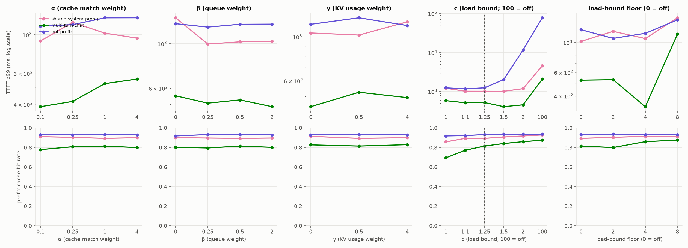

All runs

| workload | α | β | γ | c | floor | p50 ms | p99 ms | hit rate | errors |
|---|---:|---:|---:|---:|---:|---:|---:|---:|---:|
| shared-system-prompt | 0.1 | 0.5 | 0.5 | 1.25 | 0 | 85 | 922 | 0.910 | 0 |
| shared-system-prompt | 0.25 | 0.5 | 0.5 | 1.25 | 0 | 86 | 1176 | 0.903 | 0 |
| shared-system-prompt | 1 | 0.5 | 0.5 | 1.25 | 0 | 84 | 1022 | 0.893 | 0 |
| shared-system-prompt | 4 | 0.5 | 0.5 | 1.25 | 0 | 84 | 957 | 0.900 | 0 |
| shared-system-prompt | 1 | 0 | 0.5 | 1.25 | 0 | 84 | 1345 | 0.900 | 0 |
| shared-system-prompt | 1 | 0.25 | 0.5 | 1.25 | 0 | 86 | 996 | 0.896 | 0 |
| shared-system-prompt | 1 | 2 | 0.5 | 1.25 | 0 | 88 | 1030 | 0.896 | 0 |
| shared-system-prompt | 1 | 0.5 | 0 | 1.25 | 0 | 84 | 1048 | 0.914 | 0 |
| shared-system-prompt | 1 | 0.5 | 4 | 1.25 | 0 | 86 | 1191 | 0.900 | 0 |
| shared-system-prompt | 1 | 0.5 | 0.5 | 1 | 0 | 87 | 1219 | 0.857 | 0 |
| shared-system-prompt | 1 | 0.5 | 0.5 | 1.1 | 0 | 84 | 1024 | 0.893 | 0 |
| shared-system-prompt | 1 | 0.5 | 0.5 | 1.5 | 0 | 87 | 1019 | 0.907 | 0 |
| shared-system-prompt | 1 | 0.5 | 0.5 | 2 | 0 | 91 | 1189 | 0.918 | 0 |
| shared-system-prompt | 1 | 0.5 | 0.5 | 100 | 0 | 903 | 4590 | 0.928 | 0 |
| shared-system-prompt | 1 | 0.5 | 0.5 | 1.25 | 2 | 84 | 1214 | 0.903 | 0 |
| shared-system-prompt | 1 | 0.5 | 0.5 | 1.25 | 4 | 87 | 1073 | 0.914 | 0 |
| shared-system-prompt | 1 | 0.5 | 0.5 | 1.25 | 8 | 100 | 1531 | 0.910 | 0 |
| multi-turn-chat | 0.1 | 0.5 | 0.5 | 1.25 | 0 | 89 | 388 | 0.778 | 0 |
| multi-turn-chat | 0.25 | 0.5 | 0.5 | 1.25 | 0 | 90 | 416 | 0.807 | 0 |
| multi-turn-chat | 1 | 0.5 | 0.5 | 1.25 | 0 | 83 | 525 | 0.814 | 0 |
| multi-turn-chat | 4 | 0.5 | 0.5 | 1.25 | 0 | 87 | 558 | 0.799 | 0 |
| multi-turn-chat | 1 | 0 | 0.5 | 1.25 | 0 | 86 | 551 | 0.802 | 0 |
| multi-turn-chat | 1 | 0.25 | 0.5 | 1.25 | 0 | 84 | 506 | 0.795 | 0 |
| multi-turn-chat | 1 | 2 | 0.5 | 1.25 | 0 | 84 | 486 | 0.801 | 0 |
| multi-turn-chat | 1 | 0.5 | 0 | 1.25 | 0 | 85 | 444 | 0.827 | 0 |
| multi-turn-chat | 1 | 0.5 | 4 | 1.25 | 0 | 84 | 494 | 0.829 | 0 |
| multi-turn-chat | 1 | 0.5 | 0.5 | 1 | 0 | 101 | 587 | 0.694 | 0 |
| multi-turn-chat | 1 | 0.5 | 0.5 | 1.1 | 0 | 89 | 518 | 0.772 | 0 |
| multi-turn-chat | 1 | 0.5 | 0.5 | 1.5 | 0 | 83 | 412 | 0.840 | 0 |
| multi-turn-chat | 1 | 0.5 | 0.5 | 2 | 0 | 85 | 460 | 0.859 | 0 |
| multi-turn-chat | 1 | 0.5 | 0.5 | 100 | 0 | 498 | 2089 | 0.874 | 0 |
| multi-turn-chat | 1 | 0.5 | 0.5 | 1.25 | 2 | 85 | 529 | 0.799 | 0 |
| multi-turn-chat | 1 | 0.5 | 0.5 | 1.25 | 4 | 84 | 333 | 0.859 | 0 |
| multi-turn-chat | 1 | 0.5 | 0.5 | 1.25 | 8 | 88 | 1159 | 0.875 | 0 |
| hot-prefix | 0.1 | 0.5 | 0.5 | 1.25 | 0 | 79 | 1121 | 0.932 | 0 |
| hot-prefix | 0.25 | 0.5 | 0.5 | 1.25 | 0 | 80 | 1142 | 0.928 | 0 |
| hot-prefix | 1 | 0.5 | 0.5 | 1.25 | 0 | 79 | 1249 | 0.932 | 0 |
| hot-prefix | 4 | 0.5 | 0.5 | 1.25 | 0 | 79 | 1250 | 0.928 | 0 |
| hot-prefix | 1 | 0 | 0.5 | 1.25 | 0 | 80 | 1257 | 0.918 | 0 |
| hot-prefix | 1 | 0.25 | 0.5 | 1.25 | 0 | 81 | 1209 | 0.932 | 0 |
| hot-prefix | 1 | 2 | 0.5 | 1.25 | 0 | 79 | 1251 | 0.928 | 0 |
| hot-prefix | 1 | 0.5 | 0 | 1.25 | 0 | 79 | 1158 | 0.928 | 0 |
| hot-prefix | 1 | 0.5 | 4 | 1.25 | 0 | 80 | 1142 | 0.928 | 0 |
| hot-prefix | 1 | 0.5 | 0.5 | 1 | 0 | 79 | 1247 | 0.918 | 0 |
| hot-prefix | 1 | 0.5 | 0.5 | 1.1 | 0 | 79 | 1176 | 0.921 | 0 |
| hot-prefix | 1 | 0.5 | 0.5 | 1.5 | 0 | 109 | 2039 | 0.935 | 0 |
| hot-prefix | 1 | 0.5 | 0.5 | 2 | 0 | 7762 | 11620 | 0.935 | 0 |
| hot-prefix | 1 | 0.5 | 0.5 | 100 | 0 | 34456 | 77367 | 0.935 | 0 |
| hot-prefix | 1 | 0.5 | 0.5 | 1.25 | 2 | 79 | 1076 | 0.935 | 0 |
| hot-prefix | 1 | 0.5 | 0.5 | 1.25 | 4 | 84 | 1174 | 0.932 | 0 |
| hot-prefix | 1 | 0.5 | 0.5 | 1.25 | 8 | 87 | 1477 | 0.932 | 0 |

## M2 — Router view vs worker metrics

Under load (8 req/s, 4 workers), 2840 router readings of (running, waiting, KV usage) were compared with the workers' own `/metrics` sampled every ~40 ms: **99.6%** matched a worker sample from within one scrape interval (250 ms, +60 ms sampling slack). Reproduce with `python experiments/check_stats.py`.

### GPU / vLLM (M7)

Not produced yet. `make bench-gpu` creates one AWS g6.12xlarge spot VM (4× L4), deploys the chart with four vLLM
workers (Qwen2.5-7B-Instruct, prefix caching on), runs E1, E2, E3 and E8 and copies the results back; the sections
then appear here (≈ $5–10 per session, decisions D20). Re-check the recommended settings (D21) there.

### Kubernetes (k3s via k3d) — E4–E6 with Chaos Mesh

The same scenarios run against the Helm release on a 3-node k3s cluster (`make cluster-up`,
`make exp-k8s NAME=e4|e5|e6`): 2 router replicas, 4 simulated-worker pods with sidecars, membership from the
headless Service's DNS, failures injected by Chaos Mesh (PodChaos pod-kill, NetworkChaos partition). Prometheus,
Grafana (dashboard from `deploy/grafana/dashboards/relay.json`) and Jaeger run in the cluster.

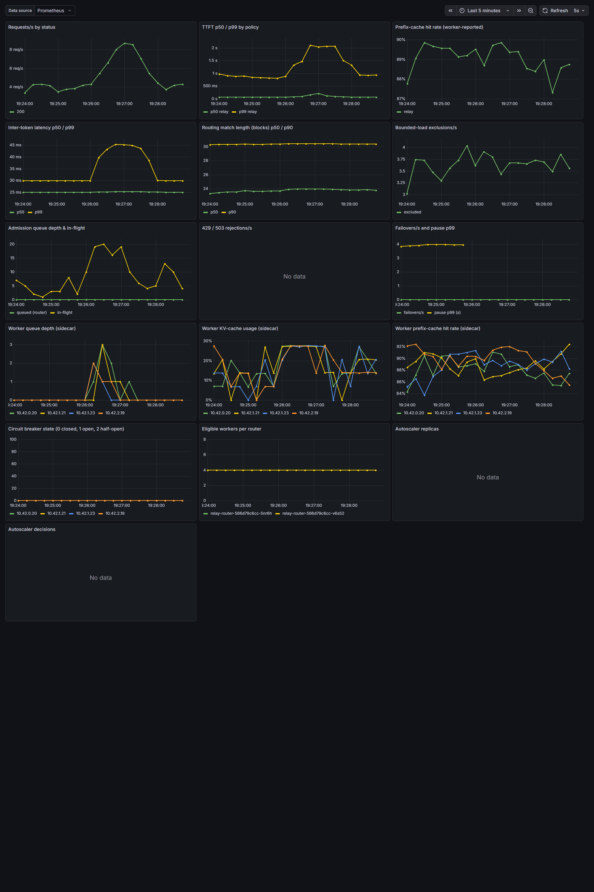

*Grafana during a 4 req/s shared-system-prompt run on the cluster (`scripts/grafana-screenshots.sh`). The autoscaler
panels are empty because fixed-size experiments disable it; in-cluster it scaled the idle pool 4 → 3 → 2 against
Prometheus with logged reasons.*

## E4 — Killing workers mid-stream (k8s)

`relay` policy, 4 workers, `shared-system-prompt` at 3 req/s with 120-token responses (long streams, so the kill lands
mid-generation). Rolling crashes: every 10 s from 15 s one worker is killed (SIGKILL, no drain) and restarted 5 s
later with an empty cache, so at most one of four workers is down at a time.

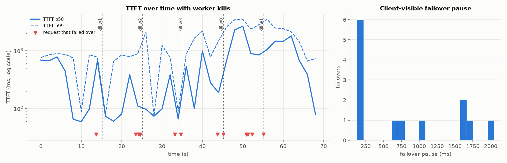

| requests | client-visible errors | requests that failed over | failovers | pause p50 ms | pause p99 ms | pause max ms |
|---:|---:|---:|---:|---:|---:|---:|
| 220 | 0 | 13 | 13 | 655 | 2007 | 2050 |

| kill | streams failed over | pause p50 ms | pause max ms |
|---|---:|---:|---:|
| w1 at 15s | 1 | 167 | 167 |
| w2 at 25s | 4 | 147 | 1624 |
| w3 at 35s | 2 | 455 | 751 |
| w0 at 45s | 1 | 1049 | 1049 |
| w1 at 55s | 3 | 1661 | 2050 |

Every request that was streaming on a killed worker was continued on another worker on the same client connection;
the client sees a pause, not an error. The pause is dominated by re-prefilling `prompt + generated_so_far` on the new
worker (the dead worker's KV cache is lost) plus any wait for a free slot there. In an earlier run with a second kill
(2 of 4 workers left, 200-token streams) the survivors were overloaded and pauses grew to 4–6 s of queueing: failover
keeps streams alive but cannot create capacity.

## E5 — Network partition of one worker (k8s)

Worker w1 is partitioned from 20 s to 40 s (its model server stops responding and its sidecar stream goes silent).
Detection uses three independent signals, whichever fires first: sidecar silence (> `SIDECAR_TIMEOUT_MS` = 1.5 s),
failed active health checks (every 0.5 s here), and the per-stream stall timer (`STALL_TIMEOUT_MS` = 1.5 s here).
In-flight streams on w1 are abandoned as soon as the pool marks it down and continued elsewhere.

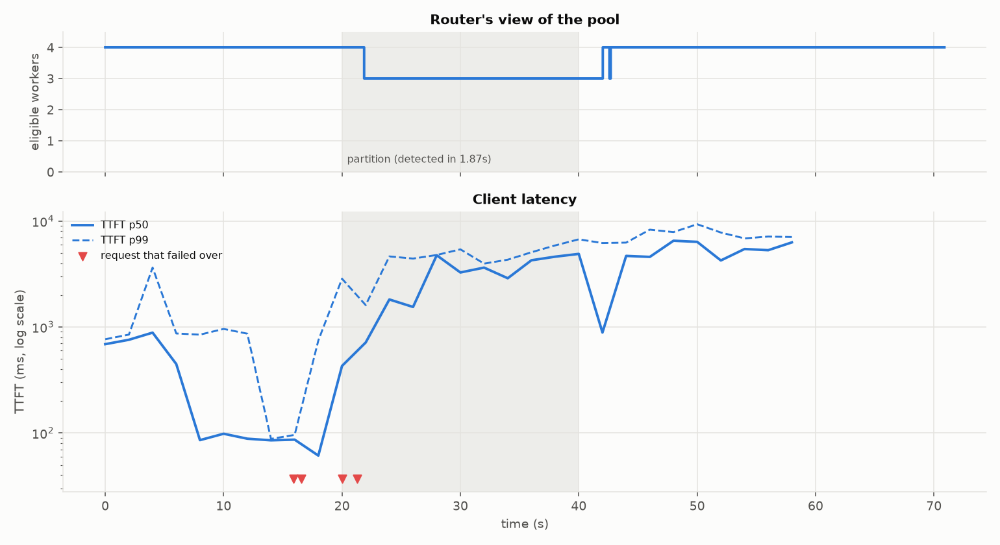

| requests | client-visible errors | error rate | failovers | detection time (s) | time to re-admit after heal (s) | max failover pause (ms) |
|---:|---:|---:|---:|---:|---:|---:|
| 194 | 0 | 0.000 | 4 | 1.87 | 2.03 | 3230 |

## E6 — Killing a router replica (k8s)

Two router replicas, each building its own prefix index from its own decisions and its own sidecar streams (no shared
state). The load generator spreads requests over both and retries connection failures on the other replica. Router-1
is killed at 20 s and restarted at 35 s with an empty index. (Requests are bucketed by start time, so streams that
started on router-1 shortly before the kill show up as retries just before 20 s.)

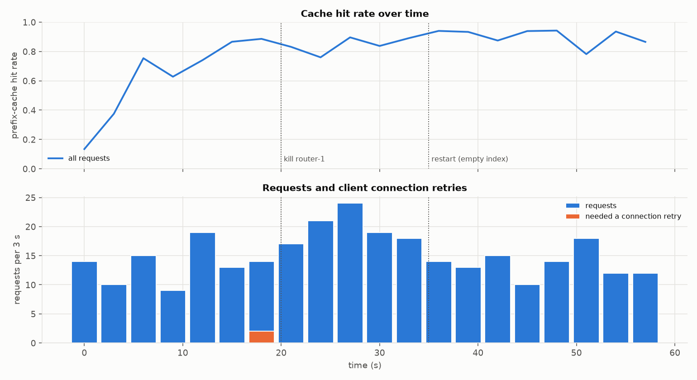

| requests | dropped (client-visible errors) | requests that needed a connection retry | hit rate before kill | one router | first 5 s after restart | last 15 s |
|---:|---:|---:|---:|---:|---:|---:|
| 301 | 0 | 2 | 0.784 | 0.845 | 0.938 | 0.883 |

## 5. Failure-mode analysis

| Failure | Detection | What the client sees | Measured |
|---|---|---|---|
| Worker process crash (SIGKILL) | broken upstream connection (immediate); health check + breaker for new requests | a pause while the continuation is prefilled elsewhere, then the rest of the stream | E4 |
| Worker partitioned / hung | first of: sidecar silence (1.5 s), failed health checks, stall timer | pause ≈ detection time + re-prefill | E5 |
| Worker slow but alive | stall timer only between tokens; a busy worker before its first token is *not* failed over (D9) | higher TTFT | E3 regression (fixed) |
| Router replica crash | client connection error | client retries on the other replica; the request restarts from scratch | E6 |
| Router restart | — | none; its prefix index starts empty and refills from routing decisions | E6 hit-rate dip |
| Worker scale-down | sidecar announces DRAINING; preStop blocks until idle | nothing | E7 |
| Worker restart (cache lost) | sidecar epoch change → router clears that worker's index | lower hit rate until it re-warms | E4 (restarts) |
| All workers down / overloaded | admission capacity 0 / queue full or deadline unreachable | 503 / 429 with Retry-After | unit + API tests |
| Failover budget exhausted | > `MAX_FAILOVERS` consecutive failures | clean SSE error event, then `[DONE]` | API test |

## 6. What didn't work, and why

* **One timer for "stalled" and "slow to start".** The first failover loop used `STALL_TIMEOUT_MS` for the first
  token too. Under hot-prefix load (E3) requests legitimately queue at a busy worker for longer than the stall
  timeout. They were failed over, re-queued elsewhere, and tripped the circuit breakers of healthy workers, causing
  10 client errors in a 25 s run. Fix (D9/D10): a separate, long first-token timeout, plus abandoning a stream only
  when the pool actually marks its worker down. The rerun had 0 errors.
* **Single-run p99s.** E1 initially ran each cell once (~250 requests). On `unique`, relay's p99 looked 50 % worse
  than least_loaded's. Three seeds showed the two policies swap order from seed to seed with identical p50s: it was
  noise from ranking on 2–3 tail samples. E1 now pools 3 seeds per cell and reports the per-seed p99 range.
* **Cache affinity vs. tail latency against consistent hashing.** consistent_hash pins each prefix to exactly one
  worker, so it gets the *highest* hit rate on every shared-prefix workload, at the cost of hotspots (E2, E3). Relay
  deliberately replicates hot prefixes once a worker is c× over average, which costs some hit rate. A large part of
  that cost is integer granularity in the bounded-load rule at light load: with 4 workers, one worker running a
  single request while the others are idle is already "over" `ceil(1.25·2/4) = 1`. E8 measures an optional
  `LOAD_BOUND_FLOOR` that exempts workers below a given load; see E8 for whether it pays off.
* **Global admission queue.** One FIFO for the whole router means a hotspot worker that holds most dispatch slots
  also delays requests bound for idle workers (consistent_hash in E3: high p99 even on lightly loaded workers).
  Per-worker queues would avoid it; not built (D14).
* **Autoscaler targets copied from production.** With an 800 ms TTFT target, the autoscaler scaled up before the
  E7 spike, because an uncached 1500-token prefill alone takes ~950 ms on the simulated workers. With a 30 s down
  window it began draining while the spike was still on. Targets must sit above the workload's uncached-prefill
  cost, and the down window must outlast bursts (E7).
* **Shared harness state.** Parallel local clusters for one experiment initially shared a membership file. Two E8
  sweeps crashed, and the surviving sweep's first run may have seen another cluster's workers; it was discarded and
  re-run. Each cluster now owns its file.
* **Failover cannot create capacity.** With 2 of 4 workers killed (an early E4 variant), continuations waited
  4–6 s for a slot on the overloaded survivors. Failover turns errors into pauses, but the pause is bounded only by
  spare capacity.
