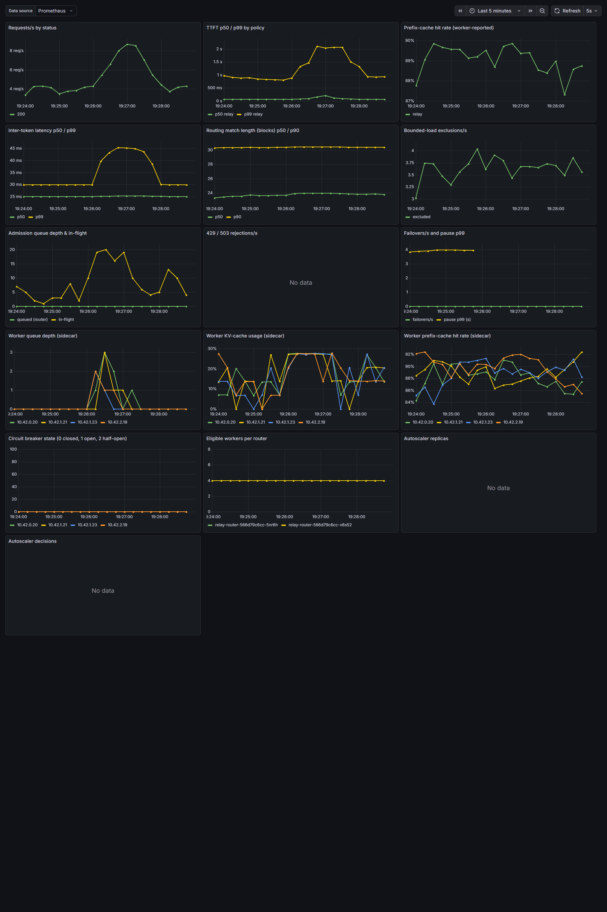

# Relay — results report

> Generated by `make report` from `docs/report.template.md` and the raw results in `results/`.
> Every figure and table below is reproducible with one command (`make exp NAME=eN`).

**Where the numbers come from.** All results in this report were produced on a laptop (12 cores, Windows 11) with
the local experiment harness: real Relay router(s) and sidecars, and **simulated workers** (`simworker`) that speak
llama.cpp's API and model a prefix KV cache (4 slots, 24k-token cache, 0.4 ms per uncached prompt token, 20 ms per
decode step, +15 % per extra concurrent sequence — roughly a 7B model on one mid-range GPU; see decisions D16). The
router code path is identical to production. One experiment (E1 on real models) uses the docker-compose stack with
real llama.cpp CPU workers. **The GPU/vLLM benchmark (M7) has not been run yet** — the tooling is in
place (`make bench-gpu`, ≈ $5–10 per session); its sections will appear here once it has.

## 1. Problem

LLM servers keep a KV cache of recently processed prompts. A request whose prompt starts with an already-cached
prefix — a shared system prompt, earlier turns of the same conversation, the same RAG document — skips recomputing
that prefix, and prefill is most of time-to-first-token (TTFT). Load balancers that ignore cache contents
(round-robin, least-loaded) scatter requests sharing a prefix across workers and recompute it everywhere. Hashing the
prefix onto a ring (consistent hashing) keeps affinity but has no load awareness: one popular prefix melts one
worker. Relay routes on *both*.

## 2. Design (short)

* **Prefix block hashes.** The prompt is tokenized (worker `/tokenize`, cached per chat-template segment) and split
  into 64-token blocks hashed as a chain, `h_i = H(h_{i-1} ‖ block_i)`, so a hash names the whole prefix up to it.
* **Per-worker prefix index.** Each router keeps, per worker, an LRU set of block hashes it has sent there, sized
  from the sidecar-reported KV capacity and cleared when the sidecar reports a restart. Match length = number of
  leading hashes present. Soft state: losing it costs hits, never correctness.
* **Scoring.** `score = α·match_blocks − β·load − γ·kv_usage`, with **bounded load**: a worker may take the request
  only if `load+1 ≤ ceil(c·(total+1)/n)` (c = 1.25). Ties: fewer in-flight, then random.
* **Live stats.** A sidecar per worker scrapes the model server every 250 ms and streams `WorkerStats` (running,
  waiting, KV usage/capacity, prefix-cache counters, restart epoch, draining) to every router over gRPC.
* **Failover.** The router holds the prompt and every token forwarded. If the worker dies, stalls (no token for
  `STALL_TIMEOUT_MS`), or the pool marks it down, it sends `prompt + generated_so_far` to another worker with the
  remaining token budget and keeps streaming on the same client connection (≤ 2 failovers).
* **Admission.** Global concurrency limit (eligible workers × 8) with a bounded FIFO queue; requests that cannot
  start before their deadline get 429 + `Retry-After` immediately.
* **HA & scaling.** Two stateless router replicas, each with its own index. An autoscaler scales workers on queue
  depth and TTFT p95; scale-down drains through the sidecar (preStop hook) so no stream is cut.

## 3. Headline comparison

Simulated 4-worker cluster. E1 columns pool 3 seeds per cell; E2 columns are from the load sweep.

<!-- headline -->

**Real-model check (llama.cpp, CPU, one run per policy — indicative):** on 3 llama.cpp workers serving
Qwen2.5-0.5B, relay had the best TTFT p50 (293 ms) and p99 (2.5 s vs 3.5–7.4 s) *and* the highest prefix-cache
hit rate as measured by llama.cpp itself (0.93 vs 0.90 consistent_hash, 0.83 least_loaded, 0.49 round_robin). A
cached ~620-token system prompt cut TTFT from 1.8 s to ~20 ms. See "E1 on real models" below.

**Findings (simulated cluster):**

1. **Relay beats round-robin and least-loaded on every shared-prefix workload, on both hit rate and TTFT p99**
   (E1): shared system prompt 0.89 vs 0.81 hit rate, p99 772 vs 881 ms; RAG 0.93 vs 0.84, p99 1199 vs 1360 ms;
   multi-turn 0.81 vs 0.63 hit rate with p50 halved (84 vs 160 ms).
2. **Relay sustains the most load at a 1 s p99 target** (E2): 8 req/s vs 6 for round-robin/least-loaded and 2 for
   consistent hashing, with the highest peak goodput.
3. **Bounded load prevents hotspots** (E3, E1 hot-prefix). consistent_hash sends 92 % of hot-prefix traffic to one
   worker and its p99 explodes to 45–65 s; relay keeps every worker within 24–27 % with p99 ≈ 1 s.
4. **consistent_hash still has the highest hit rate everywhere** (it never replicates a prefix). Relay trades a few
   points of hit rate for 2–60× lower p99. So the M3 criterion "beats *all* baselines on hit rate" is **not met**
   against consistent_hash; it is met against round-robin and least-loaded. With `LOAD_BOUND_FLOOR=4` (= worker
   slots, E8 + E1 `relay_floor4`) relay closes most of that gap — multi-turn 0.86 vs 0.88, RAG 0.95 vs 0.97 — and
   improves multi-turn p99 (399 vs 535 ms) without losing the hotspot protection.
5. **On `unique` (no sharing) relay ties least-loaded on mean, p90 and p95, but its p99 was higher in all three
   paired seeds** (1731 vs 1473 ms pooled). The γ·KV-usage term is the only difference when nothing matches; it
   uses sidecar data up to one scrape old. With γ = 0 the gap disappears (`experiments/check_gamma0.py`: p99
   1250 / 1611 / 1154 ms vs least-loaded 1425 / 1507 / 1077), and E8 shows γ = 0 is never worse on the other
   workloads. Recommended configuration for this setup: `SCORE_GAMMA=0`, `LOAD_BOUND_FLOOR=<worker slots>`;
   the code keeps the spec's defaults.
6. **c is the one parameter that matters** (E8): c ≥ 2 melts the hot prefix (p99 11.6 s at c = 2, 77 s without a
   bound), c = 1.0 costs up to 12 points of hit rate; 1.25–1.5 is the sweet spot. α, β, γ move p99 by less than the
   run-to-run noise once bounded load is in place.
7. **No failure produced a client-visible error**: rolling worker crashes (E4, 17 streams failed over, pause p50
   480 ms), a partition (E5, detected in 1.5 s), a router kill (E6, 56 requests retried on the other replica),
   and drained scale-downs (E7).

## 4. Results

<!-- include e1 -->

<!-- include e1cpu -->

<!-- include e2 -->

<!-- include e3 -->

<!-- include e4 -->

<!-- include e5 -->

<!-- include e6 -->

<!-- include e7 -->

<!-- include e8 -->

<!-- include m2 -->

### GPU / vLLM (M7)

Not produced yet. `make bench-gpu` creates one AWS g6.12xlarge spot VM (4× L4), deploys the chart with four vLLM
workers (Qwen2.5-7B-Instruct, prefix caching on), runs E1, E2, E3 and E8 and copies the results back; the sections
then appear here (≈ $5–10 per session, decisions D20). Re-check the recommended settings (D21) there.

<!-- include e1-gpu -->

<!-- include e2-gpu -->

<!-- include e3-gpu -->

### Kubernetes (k3s via k3d) — E4–E6 with Chaos Mesh

The same scenarios run against the Helm release on a 3-node k3s cluster (`make cluster-up`,
`make exp-k8s NAME=e4|e5|e6`): 2 router replicas, 4 simulated-worker pods with sidecars, membership from the
headless Service's DNS, failures injected by Chaos Mesh (PodChaos pod-kill, NetworkChaos partition). Prometheus,
Grafana (dashboard from `deploy/grafana/dashboards/relay.json`) and Jaeger run in the cluster.

*Grafana during a 4 req/s shared-system-prompt run on the cluster (`scripts/grafana-screenshots.sh`). The autoscaler
panels are empty because fixed-size experiments disable it; in-cluster it scaled the idle pool 4 → 3 → 2 against
Prometheus with logged reasons.*

<!-- include e4-k8s -->

<!-- include e5-k8s -->

<!-- include e6-k8s -->

## 5. Failure-mode analysis

| Failure | Detection | What the client sees | Measured |
|---|---|---|---|
| Worker process crash (SIGKILL) | broken upstream connection (immediate); health check + breaker for new requests | a pause while the continuation is prefilled elsewhere, then the rest of the stream | E4 |
| Worker partitioned / hung | first of: sidecar silence (1.5 s), failed health checks, stall timer | pause ≈ detection time + re-prefill | E5 |
| Worker slow but alive | stall timer only between tokens; a busy worker before its first token is *not* failed over (D9) | higher TTFT | E3 regression (fixed) |
| Router replica crash | client connection error | client retries on the other replica; the request restarts from scratch | E6 |
| Router restart | — | none; its prefix index starts empty and refills from routing decisions | E6 hit-rate dip |
| Worker scale-down | sidecar announces DRAINING; preStop blocks until idle | nothing | E7 |
| Worker restart (cache lost) | sidecar epoch change → router clears that worker's index | lower hit rate until it re-warms | E4 (restarts) |
| All workers down / overloaded | admission capacity 0 / queue full or deadline unreachable | 503 / 429 with Retry-After | unit + API tests |
| Failover budget exhausted | > `MAX_FAILOVERS` consecutive failures | clean SSE error event, then `[DONE]` | API test |

## 6. What didn't work, and why

* **One timer for "stalled" and "slow to start".** The first failover loop used `STALL_TIMEOUT_MS` for the first
  token too. Under hot-prefix load (E3) requests legitimately queue at a busy worker for longer than the stall
  timeout. They were failed over, re-queued elsewhere, and tripped the circuit breakers of healthy workers, causing
  10 client errors in a 25 s run. Fix (D9/D10): a separate, long first-token timeout, plus abandoning a stream only
  when the pool actually marks its worker down. The rerun had 0 errors.
* **Single-run p99s.** E1 initially ran each cell once (~250 requests). On `unique`, relay's p99 looked 50 % worse
  than least_loaded's. Three seeds showed the two policies swap order from seed to seed with identical p50s: it was
  noise from ranking on 2–3 tail samples. E1 now pools 3 seeds per cell and reports the per-seed p99 range.
* **Cache affinity vs. tail latency against consistent hashing.** consistent_hash pins each prefix to exactly one
  worker, so it gets the *highest* hit rate on every shared-prefix workload, at the cost of hotspots (E2, E3). Relay
  deliberately replicates hot prefixes once a worker is c× over average, which costs some hit rate. A large part of
  that cost is integer granularity in the bounded-load rule at light load: with 4 workers, one worker running a
  single request while the others are idle is already "over" `ceil(1.25·2/4) = 1`. E8 measures an optional
  `LOAD_BOUND_FLOOR` that exempts workers below a given load; see E8 for whether it pays off.
* **Global admission queue.** One FIFO for the whole router means a hotspot worker that holds most dispatch slots
  also delays requests bound for idle workers (consistent_hash in E3: high p99 even on lightly loaded workers).
  Per-worker queues would avoid it; not built (D14).
* **Autoscaler targets copied from production.** With an 800 ms TTFT target, the autoscaler scaled up before the
  E7 spike, because an uncached 1500-token prefill alone takes ~950 ms on the simulated workers. With a 30 s down
  window it began draining while the spike was still on. Targets must sit above the workload's uncached-prefill
  cost, and the down window must outlast bursts (E7).
* **Shared harness state.** Parallel local clusters for one experiment initially shared a membership file. Two E8
  sweeps crashed, and the surviving sweep's first run may have seen another cluster's workers; it was discarded and
  re-run. Each cluster now owns its file.
* **Failover cannot create capacity.** With 2 of 4 workers killed (an early E4 variant), continuations waited
  4–6 s for a slot on the overloaded survivors. Failover turns errors into pauses, but the pause is bounded only by
  spare capacity.
